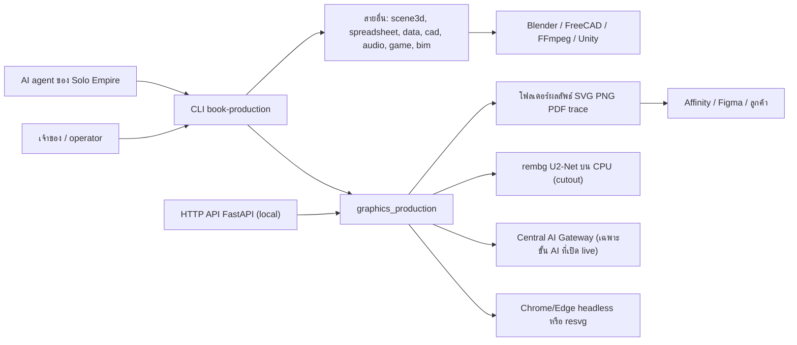
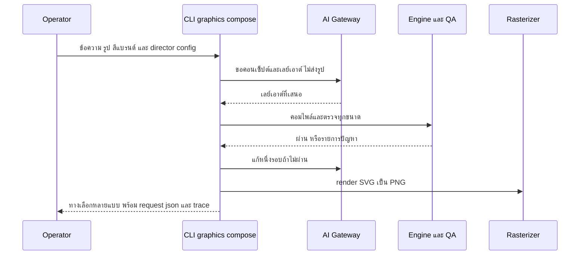
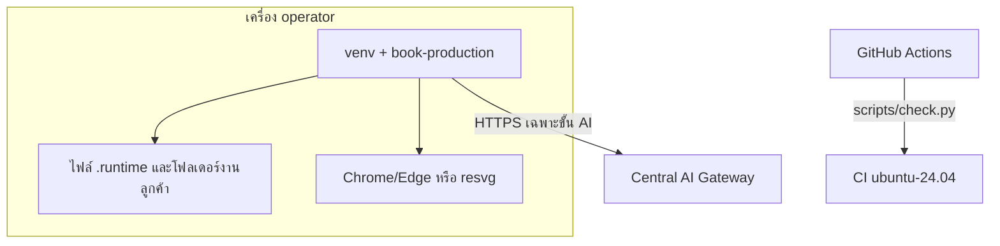

# Book Production Platform — System Architecture

## 1. Context diagram

ทุกอย่างรันบนเครื่อง local; asset ไม่ออกจากเครื่อง การเรียกเครือข่ายมีเฉพาะขั้น AI ที่ไปยัง Central AI Gateway ตาม provider config

## 2. Components

### 2.1 ระดับ platform

| Component | Path | หน้าที่ |
|---|---|---|
| CLI dispatcher | `src/book_production_platform/cli.py` | กลุ่มคำสั่ง `scene`, `graphics`, `game`, `spreadsheet`, `audio`, `cad`, `data`, `bim`, `pipeline`, `doctor` |
| Doctor | `doctor.py` | ตรวจ runtime offline (python, freecadcmd, ffmpeg, blender, unity) |
| IR packages | `*_ir/` | schema/validation ของแต่ละสาย (`graphics_ir`, `scene3d`, `spreadsheet_ir`, `data_pipeline_ir`, `cad_ir`, `audio_ir`, `game_ir`, `bim_ir`) |
| Production packages | `*_production/`, `data_pipeline/`, `scene3d/` | engine ของแต่ละสาย |
| Shared kits | `brief_adapter_kit/`, `production_trace/`, `file_intake/` | adapter AI กลาง (`brief-adapter.v1`), trace/history/manual, รับไฟล์ |
| Pipeline | `pipeline/`, `pipeline/scene-render-batch.v1.schema.json` | orchestration scene → graphics |

### 2.2 สาย Graphics (โฟกัส)

| โมดูล | หน้าที่ |
|---|---|
| `cli.py` | คำสั่ง `batch`, `export`, `brief`, `themes`, `make`, `controls`, `edit`, `styles`, `compose`, `style-create`, `edit-shadow`, `compose-campaign`, `campaign-brief`, `campaign-brief-shadow`, `review`, `feedback`, `feedback-report`, `compose-shadow`, `brief-shadow` |
| `jobs.py` | `run_batch`: idempotency, โฟลเดอร์ต่อ batch, replay, manifest |
| `themes.py`, `themes/*.json`, `motifs.py`, `templates.py` | ธีมแบบข้อมูล (`graphic-theme.v1`) คอมไพล์เป็น `graphic-ir.v1/v2` |
| `layout.py`, `layouts.py`, `box_text.py`, `fonts.py` | จัดข้อความ, ตัดคำไทย, fit text, จัดกึ่งกลางตามหมึก |
| `composer.py`, `composer_ai.py`, `aesthetics.py`, `design_principles.py` | compose เลย์เอาต์ต่องาน, คะแนนดีไซน์, AI art director |
| `campaign.py`, `campaign_brief.py` | แคมเปญหลายโพสต์, brief → แผน |
| `art_styles.py`, `art_style_ai.py`, `art_styles/` | art style pack, AI style designer |
| `assets.py`, `image_fx.py` | รูป, cutout, แต่งภาพ, โลโก้ |
| `render.py`, `export.py` | SVG → PNG (browser/resvg), export scale/DPI/PDF |
| `qa.py` | ตรวจ overflow, ทับ, contrast WCAG |
| `design_edit.py`, `design_edit_shadow.py`, `provider.py`, `provider_config.py`, `shadow.py` | AI design editor และ brief adapter พร้อม shadow eval |
| `review.py`, `telemetry.py`, `manual.py` | review.html + feedback, telemetry, MANUAL-STEPS |
| `main.py` | FastAPI: `GET /health`, `POST /v1/graphics/batches` |

ขนาดโค้ด graphics_production ประมาณ 11.8k บรรทัด (นับเฉพาะ `*.py` ระดับบนของแพ็กเกจ)

## 3. Tech stack

| ชั้น | เทคโนโลยี |
|---|---|
| ภาษา | Python ≥ 3.12 |
| Dependencies หลัก | fastapi, pydantic 2, Pillow 12, xlsxwriter |
| Optional | `resvg-py` (preview), `pythainlp` (ตัดคำไทย), `rembg[cpu]` (cutout) |
| Test/quality | pytest 9, ruff, mypy strict (pin `platform = "win32"`), httpx |
| Runtime ภายนอก | Chrome/Edge (rasterize), Blender 5.2.2 LTS, FreeCAD 1.1.3, FFmpeg, Unity |
| CI | GitHub Actions ubuntu-24.04 |

## 4. Data stores

ไม่มีฐานข้อมูล ทุกอย่างเป็นไฟล์

| ที่เก็บ | เนื้อหา | ค่าเริ่มต้น |
|---|---|---|
| Output root | `<batch_id>/` (SVG, PNG, `trace.json`, `ir.json`, `MANUAL-STEPS.md`), `manifest-<id>.json`, `history.jsonl` | ตาม `--output` หรือ `GRAPHICS_PRODUCTION_OUTPUT_ROOT` (`.runtime/graphics-production`) |
| คลังเลย์เอาต์ | `lay_*.json`, `feedback.jsonl` (ใช้กันซ้ำและเรียนรู้จาก review) | `.runtime/graphics-layouts` (`--layout-dir`) |
| Cutout cache | ผลตัดพื้นหลังตาม hash ของไฟล์ | `$XDG_CACHE_HOME/book-production/cutouts` หรือ `GRAPHICS_PRODUCTION_CUTOUT_CACHE` |
| Style library | art style ที่ AI สร้าง | `GRAPHICS_PRODUCTION_STYLE_DIR` (ตาม runbook ของ book-sales) |
| Provider config | gateway URL, *ชื่อ* env ของ token, rate card, caps, การอนุมัติของเจ้าของ, `mode` | `.runtime/provider-configs/*.json` |

## 5. Integrations

| ระบบ | ทิศทาง | สัญญา |
|---|---|---|
| Central AI Gateway | graphics → gateway | route เช่น `graphics.design_edit`; prompt versioned (`graphics-brief.v2`, `graphics-edit.v2`); ≤ 2 calls ต่องาน; fail closed เมื่อไม่มี config (`provider_not_configured`) |
| Browser headless | graphics → Chrome/Edge | rasterize SVG → PNG ด้วย profile แยก (`GRAPHICS_PRODUCTION_BROWSER_PROFILE`) |
| Affinity/Figma/Illustrator | ผลลัพธ์ → เครื่องมือออกแบบ | SVG `graphic-ir.v2` มี `<g>` ต่อ layer ที่แก้ต่อได้ |
| Solo Empire catalog | catalog → CLI | `catalog/production-tools.yaml` id `graphics-v1a` |
| Fork `book-graphics-production` | parity check | `scripts/graphics_fork_parity.py` |

### 5.1 ลำดับงาน compose แบบใช้ AI art director

ข้อความ "ไม่ส่งรูป" เป็นการอนุมานจาก README ที่ระบุว่า asset ไม่ออกจากเครื่อง **[ต้องยืนยัน]** payload จริงของ art director

## 6. Deployment topology

- Local เท่านั้น: ติดตั้งแบบ editable ใน venv (`.runtime/venv-platform` ของ Solo Empire หรือ `.venv` ของ repo)
- HTTP API รันได้ด้วย uvicorn บน localhost **[สมมติฐาน]** ไม่มี config deploy หรือ auth ใน `main.py`
- เครื่องหลักที่ทดสอบ Blender/FreeCAD/Unity คือ Windows host; Linux ใช้กับ graphics/spreadsheet/data/audio

## 7. ADR สำคัญ

| ID | การตัดสินใจ | เหตุผล | หลักฐาน |
|---|---|---|---|
| ADR-01 | Deterministic ก่อน, AI เฉพาะขั้นที่จำเป็น และ `model_calls: 0` ในเส้นทางปกติ | ผลซ้ำได้ ตรวจได้ ต้นทุนต่ำ | `README.md` บทนำ |
| ADR-02 | ธีมเป็นข้อมูล JSON + motif ที่ใช้ซ้ำ | เพิ่มหน้าตาใหม่โดยไม่แก้โค้ด | `themes.py`, guide §1 |
| ADR-03 | AI เสนอเฉพาะสิ่งที่อยู่ใน registry/controls; engine ตรวจและข้อความต้องคัดลอกจาก brief | กันการแต่งข้อความและค่าที่ไม่ปลอดภัย | README §AI brief adapter, §design editor |
| ADR-04 | ทุก AI flow เริ่มที่ `mode: shadow`, ต้องผ่าน eval gate และเจ้าของอนุมัติก่อน live | ควบคุมคุณภาพและต้นทุน | provider config, guide §5D |
| ADR-05 | โฟลเดอร์ต่อ batch + ห้ามเขียนทับไฟล์ต่างเนื้อหา | manifest เก่าไม่พัง | `docs/UPGRADE-PLAN.md` pass 2 |
| ADR-06 | Repo นี้เป็นเจ้าของ graphics; fork แช่แข็งรับเฉพาะ safety fix | ลดการแก้สองที่ | README, `graphics_fork_parity.py` |
| ADR-07 | mypy pin เป็น win32 | ผลเหมือนกันบน Linux CI และ Windows host | `pyproject.toml` |

## การอนุมัติ

| บทบาท | สถานะ | วันที่ | ลงนาม |
|---|---|---|---|
| Solution Architect (Book Dev) | รอตรวจ | — | [ต้องยืนยัน] |

## แหล่งข้อมูล

- `README.md`, `pyproject.toml`, `docs/GRAPHICS-THEMES-GUIDE.md`, `docs/UPGRADE-PLAN.md`
- `src/book_production_platform/cli.py`, `src/book_production_platform/graphics_production/` (`cli.py`, `main.py`, `jobs.py`, `provider_config.py`)
- `pipeline/scene-render-batch.v1.schema.json`, `scripts/check.py`, `.github/workflows/ci.yml`
- Solo Empire: `catalog/production-tools.yaml`, `projects/marketing/growth/book-sales/templates/offers/graphic-job-runbook.md`
