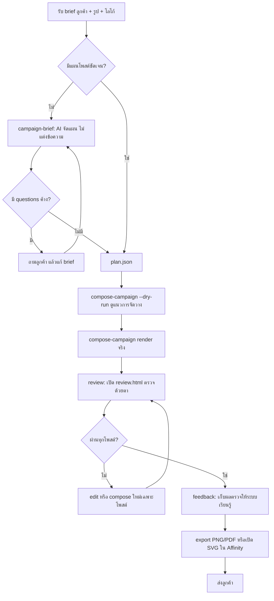
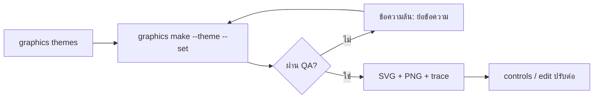
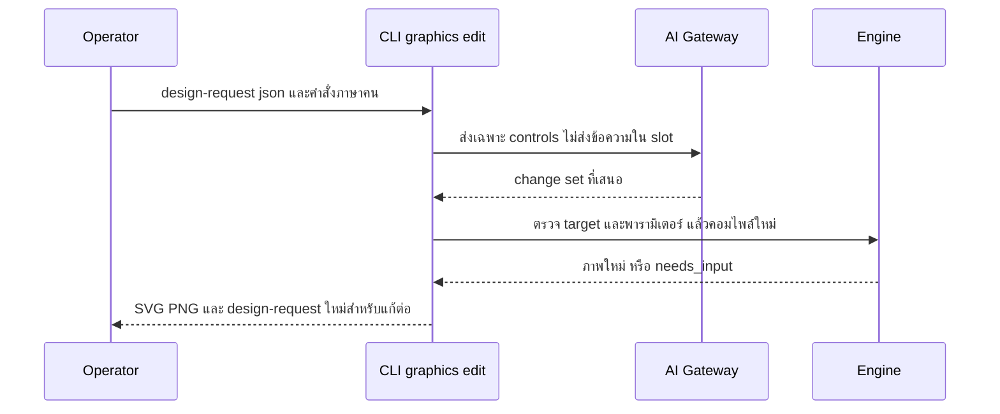

# Book Production Platform — User Flow และ Screen Inventory

## 1. รายการหน้าจอ / พื้นผิวการใช้งาน

ระบบไม่มี web UI ถาวร พื้นผิวการใช้งานคือ CLI, หน้า `review.html` ที่สร้างต่องาน, HTTP API และไฟล์ผลลัพธ์ที่เปิดในเครื่องมือออกแบบ

| ID | พื้นผิว | ชื่อ | บทบาท | สถานะ |
|---|---|---|---|---|
| SC-01 | CLI `graphics themes` / `styles` | ดูธีมและ art style ที่มี | Operator | มีแล้ว |
| SC-02 | CLI `graphics make` / `batch` | สร้างภาพจากธีม / JSON | Operator, AI agent | มีแล้ว |
| SC-03 | CLI `graphics compose` | ออกแบบเลย์เอาต์ใหม่ต่องาน | Operator | มีแล้ว |
| SC-04 | CLI `graphics campaign-brief` → `compose-campaign` | brief ลูกค้า → แผน → ทั้งแคมเปญ | Operator | มีแล้ว (brief เป็น shadow) |
| SC-05 | CLI `graphics controls` / `edit` | ปรับดีไซน์เอง / ด้วย AI | Operator | มีแล้ว |
| SC-06 | `review.html` (จาก `graphics review`) | ตรวจทุกทางเลือกทุกขนาด กดผ่าน/ไม่ผ่าน ใส่เหตุผล แล้วบันทึก `review-feedback.json` | เจ้าของ/ผู้ตรวจ | มีแล้ว |
| SC-07 | CLI `graphics feedback` / `feedback-report` | นำผลตรวจเข้าและดูสรุป | เจ้าของ | มีแล้ว |
| SC-08 | CLI `graphics export` | ไฟล์พิมพ์ PNG scale + PDF | Operator | มีแล้ว |
| SC-09 | ไฟล์ `.svg` ใน Affinity/Figma/Illustrator | แก้ต่อแบบมี layer | Operator | มีแล้ว |
| SC-10 | `MANUAL-STEPS.md` | ขั้นตอนทำซ้ำด้วยมือใน Figma/Canva/Photoshop | Operator | มีแล้ว |
| SC-11 | HTTP `POST /v1/graphics/batches` | สร้าง batch ผ่าน API | ระบบอื่นบนเครื่อง | มีแล้ว |
| SC-12 | CLI `doctor` | ตรวจความพร้อมของเครื่อง | Operator | มีแล้ว |
| SC-13 | CLI สายอื่น (`scene`, `spreadsheet`, `data`, `cad`, `audio`, `game`, `bim`, `pipeline`) | งานผลิตสายอื่น | Operator | มีแล้ว (นอกโฟกัส) |

## 2. User flow หลัก

### 2.1 งานชุดโพสต์ลูกค้า (เส้นทางหลักของสาย graphics)

### 2.2 ภาพเดี่ยวจากธีม

### 2.3 การแก้ด้วย AI design editor

## 3. Design system / component

- **Motif** (`motifs.py`): `rect`, `ellipse`, `line`, `polygon`, `glow`, `text_block`, `display_text`, `image`, `starfield`, `perspective_grid`, `striped_sun`, `ridge`, `waves`, `blobs`, `halftone`, `rays`, `rings`, `stripes`, `grain`, `corner_frame`
- **Theme** (14): `announcement`, `bold_editorial`, `brand_board`, `editorial_hero`, `grand_opening`, `hero_poster`, `menu_board`, `numbered_list`, `product_card`, `product_hero`, `promo_sale`, `quote_card`, `soft_gradient`, `synthwave`
- **ขนาด**: square 1080×1080, portrait 1080×1350, story 1080×1920, landscape 1920×1080 (ธีม v2)
- **ฟอนต์**: font stack `builtin:display`/`serif`/`mono`/`thai`; ชุดฟอนต์ OFL ไทยและลาตินตาม guide §2
- **หลักการออกแบบ**: skill `graphic-design` ของ Solo Empire + `design_principles.py` (คะแนน 9 หลัก); กฎที่วัดได้บังคับด้วยตัวตรวจ
- **review.html**: checklist ต่อทางเลือก, ปุ่มผ่าน/ไม่ผ่าน, เหตุผล, หมายเหตุ

## การอนุมัติ

| บทบาท | สถานะ | วันที่ | ลงนาม |
|---|---|---|---|
| UX/UI (Book Dev) | รอตรวจ | — | [ต้องยืนยัน] |

## แหล่งข้อมูล

- `src/book_production_platform/graphics_production/cli.py`, `themes/`, `motifs.py`, `review.py`
- `README.md` §Graphics V1A, `docs/GRAPHICS-THEMES-GUIDE.md` §1–§6
- Solo Empire: `projects/marketing/growth/book-sales/templates/offers/graphic-job-runbook.md`, `skills/graphic-design/`
