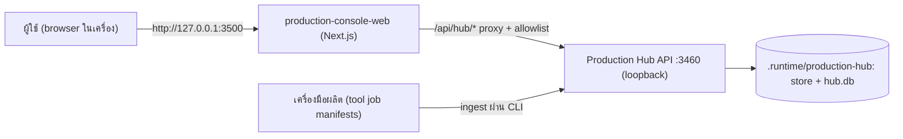
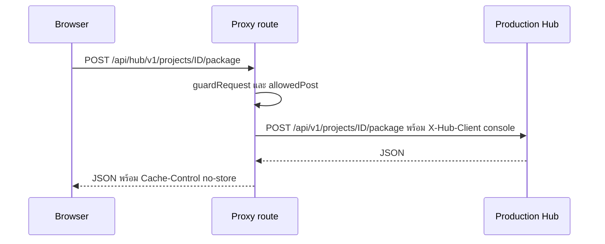
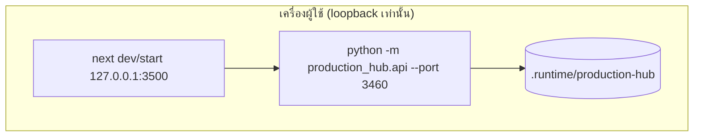

# Production Console Web — สถาปัตยกรรม

## Context diagram

## Components/containers

| Component | ที่อยู่ | หน้าที่ |
|---|---|---|
| หน้า UI | `app/page.tsx`, `app/layout.tsx`, `app/console-client.tsx` | แท็บ Library/Projects, `ArtifactDetail`, `Lineage`, `SendForm`, `ProjectDetail` |
| API client | `lib/api.ts` | เรียก `/api/hub/*`, label สถานะ review/QA, format ขนาดไฟล์ |
| Proxy route | `app/api/hub/[...path]/route.ts` | ส่งต่อ GET/POST ไป Hub; GET timeout 10 วินาที, POST 30 นาที |
| Route allowlist | `lib/routes.ts` | regex ของเส้นทาง GET/POST ที่อนุญาต (artifact id รูปแบบ `sha256:<64 hex>`) |
| Request guard | `lib/request-guard.ts` | ตรวจ Host loopback, same-origin, `Content-Type: application/json` |

## Tech stack

- Next.js 16.3.8, React 19.3, TypeScript 7
- ทดสอบ: Vitest 5 (`lib/api.test.ts`, `tests/hub-proxy-route.test.ts`)
- Playwright 1.63 อยู่ใน devDependencies แต่ไม่มีไฟล์ browser smoke **[ต้องยืนยัน]**

## Data stores

Console ไม่มีที่เก็บข้อมูลของตัวเอง ข้อมูลทั้งหมดอยู่ใน Production Hub:
- `.runtime/production-hub/store/sha256/<2>/<hex>` (content-addressed objects)
- `hub.db` (index) แยกจาก control-plane database
- ตำแหน่ง override ได้ด้วย `PRODUCTION_HUB_HOME` หรือ `--home`

## Integrations

- Production Hub API (`production_hub.api`) บน loopback เท่านั้น; proxy ปฏิเสธ origin ที่ไม่ใช่ loopback
- POST แนบ `X-Hub-Client: console` และ `Authorization: Bearer` เมื่อมีการตั้งค่า token ฝั่งเซิร์ฟเวอร์
- เครื่องมือผลิตต่าง ๆ เชื่อมผ่าน Hub (ingest manifest / send) ไม่ใช่ผ่าน Console โดยตรง

## Deployment topology

ไม่มี hosted deployment ของ Console; registry ระบุ `production-hub` ไป Railway ใน wave `durable_production`
โดยมี prerequisites `scoped_user_auth, postgres_job_store, object_storage, independent_deploy_unit` (`remote_state: unverified`)

## ADR สำคัญ

| ID | การตัดสินใจ | เหตุผล |
|---|---|---|
| ADR-01 | Console เปิดเฉพาะในเครื่องก่อน (HD5) | multi-user/hosting ต้องผ่าน design gate แยก |
| ADR-02 | browser เรียก Hub ผ่าน server-side proxy + allowlist | browser ไม่เห็น token และเรียกได้เฉพาะเส้นทางที่ตั้งใจ |
| ADR-03 | guard Host/Origin/Content-Type บน proxy | กัน confused-deputy, CSRF และ DNS rebinding (เลียนแบบ `apps/crm-web/lib/session.ts`) |
| ADR-04 | Console ไม่สร้างหน้าของ Video Studio ซ้ำ | ลิงก์เข้าและ ingest ผลลัพธ์แทน |

## การอนุมัติ

| บทบาท | สถานะ | วันที่ | ลงนาม |
|---|---|---|---|
| Solution Architect | รอพิจารณา | — | ________ |

## แหล่งข้อมูล

- `apps/production-console-web/app/api/hub/[...path]/route.ts`, `apps/production-console-web/lib/routes.ts`, `apps/production-console-web/lib/request-guard.ts`, `apps/production-console-web/lib/api.ts`, `apps/production-console-web/package.json`
- `services/production-hub/README.md`
- `docs/superpowers/specs/2026-09-30-production-hub-and-tool-coverage-design.md`
- `repository-catalog/registries/service-deployments.yaml`
