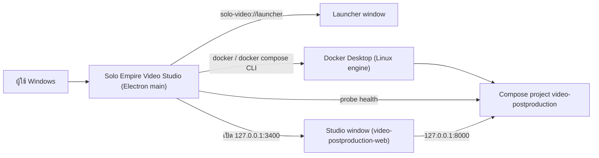
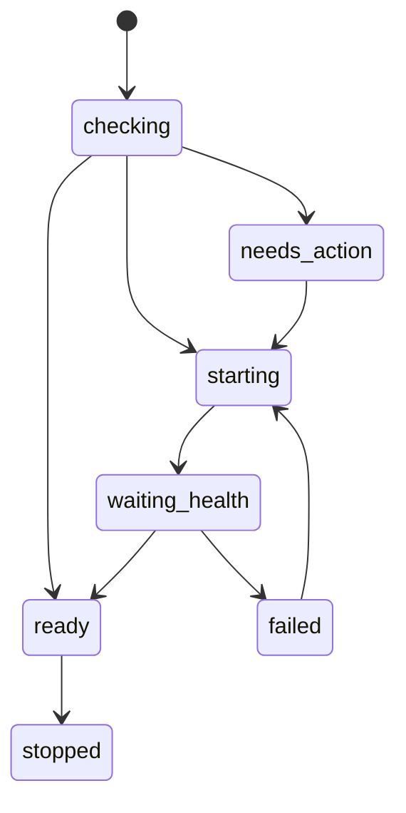
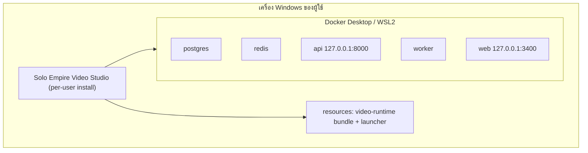

# Video Post-production Desktop — สถาปัตยกรรม

## Context diagram

## Components/containers

| Component | ที่อยู่ | หน้าที่ |
|---|---|---|
| Main process | `src/main.js` | lifecycle ของแอป, หน้าต่าง launcher/studio, IPC handlers (`getStatus`, `start`, `recover`, `status`) |
| Lifecycle | `src/electron/lifecycle.js` | single-instance lock, Squirrel startup, ยืนยันการหยุด engine |
| Runtime manager | `src/runtime/manager.js` | preflight, attach/start/recover, แปลง error เป็นข้อความไทย |
| Docker/Compose | `src/runtime/docker-cli.js`, `src/runtime/compose.js` | เรียก Docker CLI และสร้าง argument ของ compose (project, file, directory) |
| Health | `src/runtime/health.js` | probe API/web (timeout ค่าเริ่มต้น 2000 ms) |
| Paths | `src/runtime/paths.js` | หา bundle root, compose file และ `userData` ตามโหมด packaged/dev |
| Diagnostics | `src/runtime/diagnostics.js` | ทำความสะอาดข้อความ diagnostic (ปิดค่าที่ชื่อมี PASSWORD/TOKEN/SECRET/KEY) |
| Launcher UI | `src/launcher/*`, `src/protocol/launcher-protocol.js` | หน้าสถานะภาษาไทยผ่าน scheme `solo-video://` |
| Security | `src/security/*`, `src/preload.js` | window options, navigation policy, CSP ของ Studio, bridge IPC แบบจำกัด |
| Build scripts | `scripts/stage-runtime.js`, `scripts/runtime-bundle-manifest.js`, `scripts/verify-artifacts.js`, `scripts/smoke-*.js` | stage runtime bundle, ตรวจ installer, smoke test |

(ชื่อ state ใน diagram ใช้ `_` แทน `-` ของค่าใน `RuntimePhase`; transition เป็นการสรุปจากโค้ด **[ต้องยืนยัน]** รายละเอียดทุกเส้นทาง)

## Tech stack

- Electron 44.4.5, Electron Forge 7.11.2 + `@electron-forge/maker-squirrel`, `electron-squirrel-startup`
- JavaScript (CommonJS) ตรวจ type ด้วย TypeScript 7 (`tsc --noEmit`)
- ทดสอบด้วย `node --test` และ smoke ด้วย Electron (`smoke:launcher`) และ Docker (`smoke:runtime`)

## Data stores

shell ไม่มีฐานข้อมูลของตัวเอง ใช้ Electron `userData` สำหรับข้อมูลของแอป ข้อมูลงานทั้งหมดอยู่ใน named volumes
ของ Compose project: `postgres_data`, `redis_data`, `video_storage`, `whisper_cache` (ไม่ถูกลบเมื่อถอนการติดตั้ง)

## Integrations

- Docker Desktop CLI และ Docker Compose (รองรับ v5; runtime smoke ต้องการ ≥ 2.24.4)
- `apps/video-postproduction-web` (Studio window) และ `video-postproduction-api` (`connect-src` ใน CSP)
- runtime bundle (`dist/video-runtime`) สร้างจาก `services/video-postproduction/*`, `services/video-postproduction-api/*`,
  `packages/production-trace`, `apps/video-postproduction-web/*` ตาม manifest
- ลิงก์ภายนอกเดียว: หน้าเอกสารติดตั้ง Docker Desktop for Windows

## Deployment topology

แจกจ่ายเป็นไฟล์ `Solo Empire Video Studio Setup.exe` + `nupkg` + `RELEASES` ใน `dist/forge-out/make/squirrel.windows/x64`
ช่องทางเผยแพร่ **[ต้องยืนยัน]**

## ADR สำคัญ

| ID | การตัดสินใจ | เหตุผล |
|---|---|---|
| ADR-01 | Electron shell + Compose เดิม แทน PWA หรือเขียน UI ใหม่ | ใช้ UI/API/ข้อมูลเดิม ได้ installer และหน้าต่าง Windows |
| ADR-02 | attach runtime เดิมก่อนเริ่มใหม่ | ไม่สร้างฐานข้อมูลหรือคลัง media ซ้ำ |
| ADR-03 | ปิดหน้าต่างไม่หยุด runtime; หยุดเมื่อผู้ใช้ยืนยัน | ไม่ตัดงานที่กำลัง render |
| ADR-04 | renderer sandbox, ไม่มี Node integration, IPC เฉพาะ 4 ช่อง | ลดพื้นผิวการโจมตีจากเนื้อหาเว็บ |

## การอนุมัติ

| บทบาท | สถานะ | วันที่ | ลงนาม |
|---|---|---|---|
| Solution Architect | รอพิจารณา | — | ________ |

## แหล่งข้อมูล

- `apps/video-postproduction-desktop/src/main.js`, `apps/video-postproduction-desktop/src/runtime/`, `apps/video-postproduction-desktop/src/security/`, `apps/video-postproduction-desktop/src/preload.js`
- `apps/video-postproduction-desktop/forge.config.js`, `apps/video-postproduction-desktop/scripts/runtime-bundle-manifest.js`, `apps/video-postproduction-desktop/scripts/verify-artifacts.js`
- `docs/superpowers/specs/2026-09-23-video-postproduction-native-desktop-design.md`
- `services/video-postproduction/README.md`
