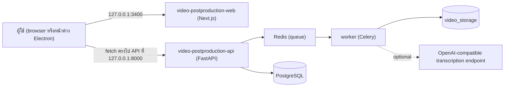
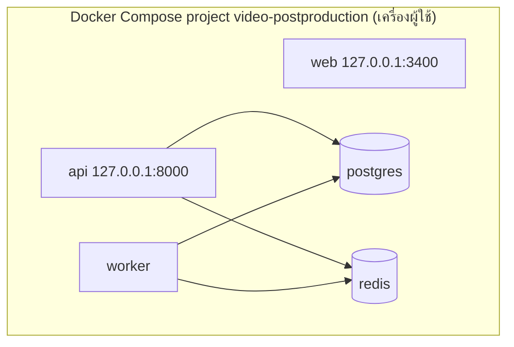

# Video Post-production Web — สถาปัตยกรรม

## Context diagram

browser เรียก API โดยตรง (ไม่ผ่าน server route ของ Next.js) API จึงต้องอนุญาต origin ของเว็บใน `CORS_ALLOWED_ORIGINS`

## Components/containers

| Component | ที่อยู่ | หน้าที่ |
|---|---|---|
| หน้า Projects | `app/page.tsx`, `components/project-list.tsx` | รายการโปรเจกต์ |
| หน้า New project | `app/new/page.tsx`, `components/project-create-form.tsx` | สร้างโปรเจกต์ เลือกคุณภาพถอดเสียง อัปโหลดวิดีโอ |
| Project Editor | `app/projects/[projectId]/page.tsx`, `components/project-editor.tsx` | metadata, video stream, EDL, render |
| Job progress | `components/job-progress.tsx` | สถานะ pipeline และ retry |
| Transcript | `components/transcript-panel.tsx`, `lib/transcript-range.ts` | แสดง transcript และคำนวณช่วงจาก segment |
| Output format | `lib/output-format.ts` | patch EDL สำหรับ 9:16 (1080x1920, `vertical_centered`) หรือ 16:9 (1920x1080, `source`) |
| API client | `lib/api.ts` | เรียก `/api/v1/*` ทั้งหมดของ API |
| UI primitives | `components/ui/button.tsx`, `components/ui/card.tsx` | ปุ่มและการ์ด |

## Tech stack

- Next.js 16.3.8, React 19.3, TypeScript 7, PostCSS
- ทดสอบ: Vitest (`lib/*.test.ts`), Playwright browser smoke (`tests/browser-smoke.mjs`)
- Container: `services/video-postproduction/Dockerfile.web` (`node:22-alpine`, `next start` พอร์ต 3000 ภายใน → `127.0.0.1:3400`)

## Data stores

เว็บไม่มีที่เก็บข้อมูลของตัวเอง ข้อมูลอยู่ฝั่ง runtime (Docker named volumes):

| Volume | ข้อมูล |
|---|---|
| `postgres_data` | โปรเจกต์ asset job EDL render |
| `redis_data` | queue ของ Celery |
| `video_storage` | original media, render, job trace/interchange (`projects/<id>/jobs/...`) |
| `whisper_cache` | model cache ของ faster-whisper |

## Integrations

- `video-postproduction-api` ผ่าน REST `/api/v1/*` (รายการ endpoint ใน `01-prd.md`)
- EDL contract ใน `packages/video-postproduction-edl`
- Transcription provider: `faster_whisper` (ค่าเริ่มต้น CPU) หรือ `openai_compatible` (เลือกได้)
- `apps/video-postproduction-desktop` เปิดเว็บนี้ในหน้าต่าง Electron ที่ `http://127.0.0.1:3400`

## Deployment topology

แผน durable production ใน registry: `video-postproduction-api` บน Railway และ `video-postproduction` บน
Cloud Run Jobs หลัง benchmark (owner repository `solo-video-production`, `proposed`) ไม่ระบุที่ deploy ของเว็บ **[ต้องยืนยัน]**

## ADR สำคัญ

| ID | การตัดสินใจ | เหตุผล |
|---|---|---|
| ADR-01 | local-first: media อยู่ใน volume เดียวกับ worker | ไม่ส่งวิดีโอเต็มไป provider ภายนอกโดย default |
| ADR-02 | browser เรียก API โดยตรงพร้อม CORS allowlist | เว็บเป็น control surface บางเบา |
| ADR-03 | FFmpeg/FFprobe รันด้วย typed argv | ไม่รับ shell command จาก UI หรือ provider |
| ADR-04 | แก้ EDL สร้าง version ใหม่ และ render ซ้ำเป็น idempotent | ตรวจย้อนได้และไม่สร้างไฟล์ซ้ำ |

## การอนุมัติ

| บทบาท | สถานะ | วันที่ | ลงนาม |
|---|---|---|---|
| Solution Architect | รอพิจารณา | — | ________ |

## แหล่งข้อมูล

- `apps/video-postproduction-web/lib/api.ts`, `apps/video-postproduction-web/lib/output-format.ts`, `apps/video-postproduction-web/package.json`, `apps/video-postproduction-web/components/`
- `services/video-postproduction/docker-compose.yml`, `services/video-postproduction/Dockerfile.web`, `services/video-postproduction/README.md`
- `services/video-postproduction-api/README.md`
- `repository-catalog/registries/service-deployments.yaml`
